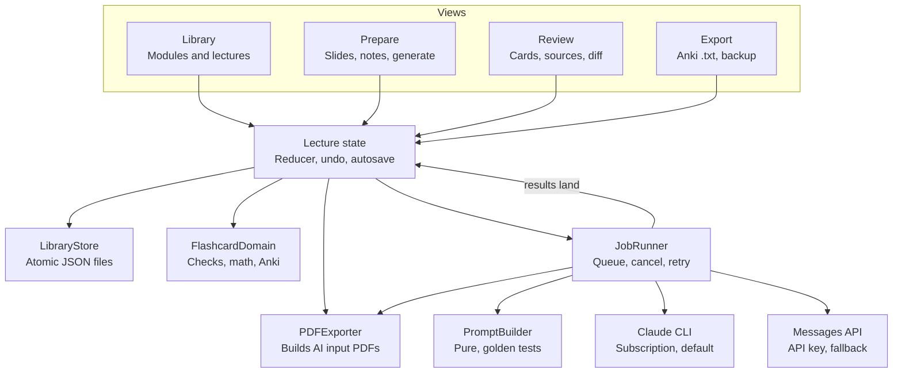

# Learning App v1 Design

2 Nov 2026 · Kai Küppers

## TL;DR

v1 is one native Mac app, **Lectern**, built on the Slide Learning codebase with the Flashcard Reviewer ported in as its second mode. A lecture goes PDF → curate → one-click generate → review with sources beside each card → export to Anki, without leaving the app.

- **Base:** Slide Learning's Swift 6 / macOS 26 code (reducer, atomic store, PDF export). Port the reviewer's domain, math and Anki export into it. Do not glue two apps together.
- **AI:** one `AIProvider` interface, two backends. Default: your installed `claude` CLI in headless mode with `--json-schema` (uses your subscription). Fallback: direct Messages API, about $0.50 per deck.
- **Four AI calls only:** Generate (deck → cards), Revise (one card + feedback → proposal), Ask (about slides while you prepare, or about a card), Distil (a chat → learning points). Everything else is local.
- **The one UX idea that matters:** AI never blocks review. Send feedback with ⌘↩, keep reviewing, accept proposals as a diff when they land.
- **Deadline reality:** exams are in December, today is 2 November. The end-to-end flow must work by 13 November or the app won't pay for itself this semester.

## PRD pushback

The PRD is mostly right: Mac only, Anki keeps scheduling, approval is separate from recall, file export. These are the parts I'd change.

| PRD says | Problem | Change |
| --- | --- | --- |
| Subscription integration is an "open decision" at the end | It's the critical path, and it's parked last | Spike it on day 1, 1 day max. `claude -p --json-schema` exists and uses your login. If it's flaky, use the API: roughly $30 for the semester (estimate below). Not worth a week of agonising. |
| Generate from all selected slides as one job | Adding 5 slides and generating again duplicates the other 40 | Default to **slides without cards only**. "Regenerate all" is a separate, confirmed action. |
| Reuse the evaluator's adjustment workflow | Its AI brief is a copy-paste batch handoff, which is the exact friction v1 removes | Drop the brief. Each Needs-adjustment card becomes its own background revision request. |
| Flashcard skill format as the baseline | `front == back` lines are a clipboard hack: split ambiguity, multiline escaping | Keep the skill's *content* rules. Replace its *syntax* with a JSON schema. Keep the line parser only for pasted imports. |
| (missing) | Later lectures recap earlier ones, so you'll approve the same card three times | Send the module's existing card fronts as "already covered, don't repeat". About 6k tokens. v1. |
| Ask questions about a card | Can grow into a chat product | One thread per slide, reachable from Prepare and Review, with the context you pick. Chats reach cards only as learning points you can see and untick. One click turns an answer into revision feedback. |
| Learning preferences from feedback: later | Agree, but the manual version is nearly free | A "Make module rule" button on any feedback appends it to the module instructions. |
| File export only, no editing exported notes | Re-exporting a module creates duplicates in Anki | Add a GUID column now. Anki's docs say a known GUID won't create a duplicate. Whether it *updates* the note is undocumented, so check it in the spike. Also add a tags column, `Module::Lecture`. |
| iPad deferred | Slide Learning still ships an iPad target with an open crash, plus iCloud shared-folder code | Freeze the iPad target and run local library only in v1. Otherwise every new field has to survive iCloud conflicts first. |

## What we keep from each app

Use `slide-learning` as the host repo: it's on Swift 6 and macOS 26 and has the better persistence layer. The reviewer is on Swift 5 and macOS 14, so its code moves up a version, not the other way round. Most of the UI already exists. The new work is the library hierarchy, the job runner, the AI layer and the proposal UI.

| Piece | From | Action | Notes |
| --- | --- | --- | --- |
| Prepare workspace (thumbnails, focus vs. selection, notes, ⌘J, Space, Esc) | Slide Learning | Keep as-is | Already the right UX. Adds a coverage badge (card count per slide), a Generate button and an Ask panel. |
| `ProjectStore`, `AtomicFileWriter`, `PDFValidating` | Slide Learning | Keep, generalise | Becomes `LibraryStore`: a module holds lectures. Same atomic JSON per lecture. |
| `PDFExporter` | Slide Learning | Keep, reuse for AI | Its output (selected slides, source numbers, notes beneath) is already the AI input you hand Claude today. Proven format, so reuse it. |
| `PDFThumbnailProvider` | Slide Learning | Keep | Also renders the source slide pane in review. |
| Shared iCloud folder, iPad target | Slide Learning | Freeze | Leave it in git and out of the v1 scheme. |
| `FlashcardDomain` (verdicts, math spans, Anki serialisation, issues) | Reviewer | Port | Most valuable code in either repo. Its tests come with it. |
| `ReviewView` (1/2/3, E/R, U, filters, undo, stable verdict bar) | Reviewer | Port, extend | Adds a source pane, proposal diff and Ask panel. |
| `MathPreviewView` + bundled MathJax | Reviewer | Port | Unchanged. |
| `ExportView` | Reviewer | Port, slim | Anki tab plus backup. The AI brief and approved-text tabs go. |
| Session model, import sheet | Reviewer | Replace | Sessions become lectures. Paste-import stays as "Add cards manually". |
| Design system (ivory, charcoal, muted green; verdict colours) | Both | Merge | Already close. Use one token file. |

## Core loop and screens

There are three screens: **Library** (modules and their lectures), a **Lecture** window with two modes, Prepare and Review (⌘1 / ⌘2), and **Export**. No new screen is needed for AI. AI shows up as a job bar, badges and a side panel. See the companion file `learning-app-v1-screens.html` for the mockups.

### The loop

1. **Import.** Drop a PDF onto a module. All slides start selected, as they do today.
2. **Prepare.** Curate and annotate exactly as in Slide Learning. Each thumbnail gets a coverage badge with its card count, so you can see which slides have no cards yet. When a slide doesn't make sense, ask in the panel on the right; Claude sees the slide and its neighbours. Each chat leaves learning points that steer the next generation.
3. **Generate (⌘G).** A small sheet shows the scope ("27 slides without cards"), the rules in force, and the cost when on the API. Start runs it in the background, with a job bar at the window's foot: Sending, then Writing, then the card count. You can keep editing, because the job works on a snapshot. Cancel discards it cleanly.
4. **Land.** A banner says "41 cards ready to review". It never switches modes for you. Slides the model skipped are listed with a reason, for example "title slide" or "no examinable content".
5. **Review.** This is the reviewer's flow plus a source pane. Every card shows its linked slides on the right. AI-flagged cards come first in an "AI flagged" filter.
6. **Revise without waiting.** Press `3`, type feedback, press ⌘↩. The request runs in the background and you move on. When the proposal lands, the card shows a badge. Open it to see a word-level diff.
7. **Export.** Approved cards that haven't been exported yet go into an Anki `.txt` for this lecture or the whole module. Cards are marked exported, and later edits mark them changed since export.

### Review keys (new ones in bold)

| Key | Action |
| --- | --- |
| `1` / `2` / `3` | Good / Bad / Needs adjustment. Unchanged. |
| **⌘↩ in feedback** | Send the feedback to AI for revision. Plain Esc keeps it as a note only. |
| **↩ on a proposal** | Accept the proposal. The card goes back to Unreviewed. |
| **⇧↩ on a proposal** | Accept and approve in one step, the common case. |
| **`X` on a proposal** | Discard it. Your text stays. |
| **`S`** | Cycle the linked source slides. Space enlarges one. |
| **`A`** | Open Ask for this card. |
| **`G`** | Jump to this card's slide in Prepare. |

### Rules that protect your work

- Generation never approves anything. Accepting a proposal never approves either, except through ⇧↩.
- A proposal records the text it was based on. If you edited the card after sending, it's marked "based on older text", and the diff is against your *current* text. Accepting puts your manual version into history. Nothing is overwritten silently.
- A revision may split a card into several. Accepting creates the new cards as Unreviewed and marks the original superseded: hidden from lists, kept in history.
- The reviewer's existing rules still hold: editing a Good card makes it Unreviewed, undo covers 50 actions, and hidden filters are revealed on undo.

## AI features

There are four calls behind one `AIProvider` interface. Everything else is deterministic local code, so you can test it without a model.

### The four calls

| Call | Sends | Gets back (JSON schema) | Effort | API cost (estimate) |
| --- | --- | --- | --- | --- |
| **Generate** | Selected slides as the existing export PDF, with source numbers and notes beneath. Notes again as a JSON list. Global rules, module instructions, and the fronts of the module's existing cards. | `cards[{front, back, sourceSlides[], flag?}]`, `skipped[{slide, reason}]` | high | ~$0.50 for 40 slides |
| **Revise** | Current card, its original, your feedback, and only the linked slides (a 1–3 page PDF from the same exporter). Rules and module instructions. | `cards[1–3]`, `rationale` | medium | ~$0.03 |
| **Ask** | The slides you picked (one, ±1, or the lecture) or a card with its linked slides, plus notes, the slide's thread so far, and your question | Streamed text | medium | ~$0.02 |
| **Distil** | One Ask thread and the slides it cites. Runs after each answer. | `learningPoints[{text, pages[]}]` | low | under $0.01 |

The costs assume about 2k tokens per PDF page at Opus 5.5 API rates ($4 / $20 per million tokens). A semester of about 25 lectures, 200 revisions and 300 questions (each with a Distil) comes to **roughly $30**. The spike replaces these guesses with measured numbers.

### Ask while you prepare

You can ask about a slide while you curate, not only about a finished card. The Ask panel sits on the right of Prepare (key `A`), and Review's Ask uses the same threads.

- **You pick what Claude sees:** this slide, the slide with its neighbours (default ±1), or the whole lecture. Pages go in as the same exporter PDF, notes included. Answers cite slide numbers, and the citations are clickable.
- **One thread per slide.** A thread belongs to the slide it started on. Ask on a card in Review opens the thread of the card's first source slide, so there are never two conversations about the same thing. Thumbnails show a Q badge where a thread exists.
- **Chats reach the cards as learning points, not transcripts.** After each answer a cheap Distil call boils the thread down to 1–3 learning points: what you didn't get, and what made it click. They sit under the chat with a checkbox. Edit or untick anything that's wrong.
- **Slide without cards:** the next Generate sends its ticked learning points along, framed as "the student found this hard, make sure a card tests it".
- **Slide with cards:** learning points never create duplicates. "Propose update" sends them as revision feedback to that slide's cards, and the result lands as a normal proposal with a diff.

Why not feed the whole chat into generation? Because a transcript is mostly your wrong guesses and Claude's explanations. Fed raw, it produces cards built around your misconceptions, costs tokens on every job, and you can't see what steered the cards. Learning points are short, visible and editable, so you stay in charge. Ships in M2 together with card Ask; it's the same thread code.

### Prompt assembly

`PromptBuilder` is a pure function with golden-file tests. Its sections, from lowest to highest precedence:

1. **Global card rules.** The Flashcards-v9 skill text, stored as a versioned `rules.md` you can edit in Settings. Short, self-contained cards; transferable over example-bound; numbered lists only when order matters; Anki math delimiters `\(…\)`.
2. **Module instructions.** Free text per module, for example "Exam is open-book on formulas, test interpretation only".
3. **Learning points.** Ticked points from your questions on the job's slides: "the student found this hard, make sure a card tests it". Slide notes still win.
4. **Slide notes.** These win, and the prompt says so explicitly.
5. **Already covered.** Fronts of the module's existing non-Bad cards: "Don't duplicate these. Write a card only if this lecture adds something new."
6. **Output contract.** The schema, plus: set `flag` when a card breaks a rule you couldn't avoid or you're unsure of it. List skipped slides with a reason.

### Small features worth their tokens

- **AI flags.** Flagged cards sort first, so your review time goes to the doubtful ones.
- **Skipped slides with reasons.** Selected slides that produced no card are visible, not silently lost.
- **Coverage badges.** Card count per slide in Prepare. They also drive "generate only uncovered slides".
- **Ask → feedback.** One click turns an answer into revision feedback.
- **Make module rule.** One click appends a piece of feedback to the module instructions. This is the manual version of "learning your preferences".

### Guardrails

- **Validate, never drop.** A `sourceSlides` value outside the job's slides, an empty side, or unbalanced math gets the reviewer's existing issue badge, and the card can't be approved until it's fixed.
- **Atomic landing.** Cards and the job's success state are written in one atomic write. A crash mid-job leaves an *Interrupted* job with Retry. Retry reuses the same job record, so there are no duplicate batches.
- **Sanity warnings.** Zero cards, or more than 3 cards per slide on average, shows a warning in the banner instead of failing quietly.
- **No chunking in v1.** One call handles up to 100 selected slides, well inside the API's 600-page and 32 MB PDF limits. Above that the app warns you. Chunking would break cross-slide context and create duplicates.

### Backends

**Default: Claude CLI (your subscription).** Spawn `claude -p --output-format json --json-schema <schema> --model opus`, with only `Read` allowed, `--permission-mode dontAsk`, and an empty per-job folder containing `input.pdf`. Do *not* use `--bare`, because bare mode ignores your subscription login. Cancel sends SIGINT. Both apps are already unsandboxed, so spawning a process works.

- Risk: without `--bare`, your `~/.claude` memory and skills load into every call. Check in the spike that they don't skew the cards.
- Policy: Anthropic doesn't let third-party products [offer claude.ai login](https://code.claude.com/docs/en/agent-sdk/overview). Running *your own* CLI on *your own* Mac is a different thing, but it means this backend can't be handed to friends.
- Limits: calls share your subscription's rate limits with your normal Claude use.

**Fallback: Messages API.** URLSession straight to `/v1/messages`, since there's no official Swift SDK. The PDF goes as a base64 `document` block, structured output via `output_config.format`, and the key lives in Keychain. Model `claude-opus-5-5`, with prompt caching on rules and module context. It's about 200 lines of code, so build it regardless; it's also the fastest way to debug prompts.

## Data model

Storage is JSON on disk, one file per lecture, written atomically with the existing `AtomicFileWriter`. A database isn't warranted. A busy lecture holds about 60 cards with history, so a few hundred KB.

```text
Library/
  rules.md                      global card rules (versioned)
  modules/<moduleID>/
    module.json                 name, instructions, lecture order
    lectures/<lectureID>/
      source.pdf                private copy (as today)
      lecture.json              slides + cards + jobs
      jobs/<jobID>/input.pdf    AI input snapshot, deleted after 7 days
```

```swift
Module   { id, name, instructions: String, lectureIDs: [UUID] }

Lecture  { id, moduleID, name, sourceFilename, pageCount,
           slides: [SlideState],          // unchanged: pageIndex, isSelected, note
           cards: [Card], threads: [Thread], jobs: [Job], viewPreferences }

Card     { id, sourcePages: [Int],         // validated against pageCount
           front, back,                     // current text
           verdict: unreviewed|good|bad|needsAdjustment,
           feedback: String,                // the reviewer's notes field
           flag: String?,                   // AI self-check
           issue: CardIssue?,               // reused from FlashcardDomain
           mathInterpretations,             // reused
           history: [Revision],             // [0] = as generated
           proposal: Proposal?,
           origin: generated(jobID)|manual|splitFrom(cardID),
           supersededBy: [UUID]?,
           exported: ExportMark? }          // revisionID + date

Thread   { id, anchorPage: Int,             // one thread per slide
           context: slide|neighbours(Int)|lecture,
           messages: [Message],             // text + cited pages
           learningPoints: [LearningPoint] }
LearningPoint { id, text, pages: [Int], included: Bool,
                usedBy: [jobID] }           // which jobs consumed it

Revision { id, front, back, author: ai|user, reason: String?, at }
Proposal { id, jobID, baseRevisionID, cards: [Draft], rationale,
           state: pending|ready|failed }
Job      { id, kind: generate|revise|ask|distil, pages: [Int],
           inputHash, rulesVersion, backend,
           state: running|succeeded|failed|cancelled|interrupted,
           error?, usage { inputTokens, outputTokens, costUSD? },
           startedAt, finishedAt? }
```

Three decisions are baked in:

- **History is append-only.** Manual edits are coalesced per editing session, so typing doesn't create 200 revisions. Accepting a proposal and restoring an original both append a revision.
- **"Changed since export"** means `exported.revisionID` differs from the latest revision. That makes re-export straightforward, and the GUID column (the card `id`) keeps Anki from duplicating the note.
- **Migration.** On first launch, existing Slide Learning projects import into an "Unsorted" module, and Reviewer sessions import as lectures without a PDF, so their cards have no sources. Both are read-only imports. The old files stay untouched.

## Architecture and stack

The stack stays as it is: SwiftUI with AppKit bridges, PDFKit, MathJax in WKWebView, Swift 6 strict concurrency, macOS 26, no third-party dependencies. The only new moving part is the job runner. Every AI call goes through it.



Views dispatch actions to one lecture state. The state calls the job runner, which builds the prompt and input PDF and calls a backend. Results come back as a single reducer action, so undo and autosave cover AI output with no special cases.

- **JobRunner** is an `actor`. It runs at most one Generate per lecture and up to 3 jobs at once overall. Every state change is persisted. On launch, any job still marked `running` becomes `interrupted` with Retry.
- **Progress** shows stages, not streamed cards. Both backends emit events (`stream-json` / SSE). Showing cards as they stream in is a v1.1 nicety.
- **Settings** covers the backend, the model, the API key (Keychain), the `rules.md` editor with version bump, and a running cost total when on the API.
- **Tests:** keep the existing reducer, store and export tests. Add PromptBuilder golden files, a `FakeAIProvider` that replays fixture JSON for UI tests, and a live smoke test behind an environment flag. Anki import stays a manual check, as in the reviewer's acceptance item 8.

## Scope, milestones, open questions

The milestones exist to protect your exam prep: usable end to end by 13 November, frozen by 27 November. If M1 slips past 13 November, cut M2 to Revise only and drop Ask, rather than slide the freeze.

| Phase | Dates | Work | Gate at the end |
| --- | --- | --- | --- |
| M0 Spike | Nov 2–4 | One real deck via the CLI and via the API; check Anki GUID behaviour | Backend chosen |
| M1 End to end | Nov 5–13 | Merge into one app; generate and review with sources; Anki export | **PRD acceptance passes** |
| M2 Revise and Ask | Nov 14–20 | Proposals with diff; Ask per card; cross-lecture dedupe | — |
| M3 Harden | Nov 21–27 | Import old data; crash and restart tests; flags and coverage polish | Freeze: bug fixes only |

M1's gate is the PRD's own acceptance test: one real deck goes all the way through and imports correctly into Anki. After 27 November the app gets bug fixes only, and the time goes into studying with it.

**Out of v1:** everything the PRD defers, plus iPad, the iCloud shared folder, chunking for decks over 100 slides, cards streaming in live, and two-way Anki sync.

### Open questions

- [ ] Does Anki *update* an existing note when the GUID matches, or only skip it? This decides whether re-exporting edited cards works. Check in M0.
- [ ] Does a non-bare `claude -p` call pull your `~/.claude` skills and memory into generation? If it does and they can't be excluded, that's an argument for the API.
- [ ] Should old data be migrated? I'd import Slide Learning projects that have notes and leave old Reviewer sessions in the old app.
- [x] App name: Lectern. Decided on 2 November.
